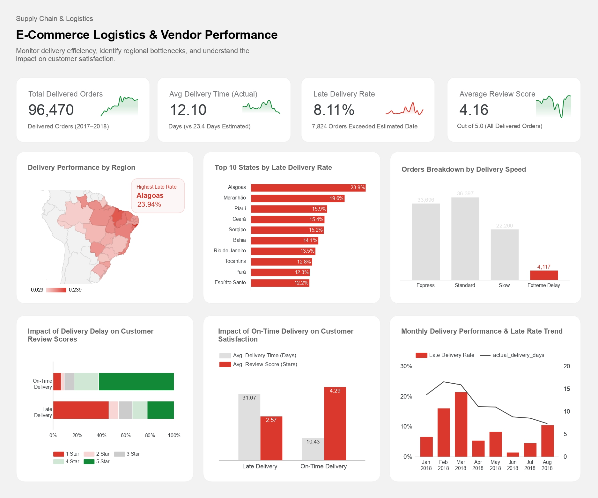

# E-Commerce Logistics & Vendor Performance Dashboard

**Where is Olist losing customers on delivery, and how much does it cost them?**

This project takes the raw Olist e-commerce dataset (Brazil, 2017–2018), models it in PostgreSQL, and turns it into a Looker Studio dashboard that answers that question. The short version: most orders arrive early, but a small group of late orders, concentrated in a few northeastern states, does a lot of damage to review scores.

**[View the live dashboard](https://datastudio.google.com/reporting/70313437-c070-4d13-9daa-4fe04e1120db)**



---

## Table of contents

1. [Background](#background)
2. [Tools and data](#tools-and-data)
3. [How the data is modeled](#how-the-data-is-modeled)
4. [What's on the dashboard](#whats-on-the-dashboard)
5. [Key findings](#key-findings)
6. [Recommendations](#recommendations)
7. [Limitations](#limitations)
8. [Reproducing this project](#reproducing-this-project)

---

## Background

Olist connects small sellers to large marketplaces across Brazil. Brazil is a big country with very uneven logistics, so a promised delivery date is a much harder promise to keep in some places than in others.

I wanted to build something an operations manager could open in the morning and get three answers quickly:

- How are we doing on delivery overall?
- Which regions are dragging that number down?
- When we deliver late, what does it do to customer satisfaction?

## Tools and data

| Layer | Tool |
|---|---|
| Database | PostgreSQL |
| SQL client | DBeaver |
| Visualization | Looker Studio |
| Data | [Olist Brazilian E-Commerce dataset](https://www.kaggle.com/datasets/olistbr/brazilian-ecommerce) |

Scope: delivered orders only (96,470 orders, 2017–2018). Canceled, unavailable, or still-in-transit orders are excluded because they have no actual delivery date to measure against.

## How the data is modeled

Instead of connecting Looker Studio to a pile of raw tables and doing the math in the report, I did the heavy lifting in SQL. The raw tables are joined once into a fact table, and a view on top of it adds the delivery speed buckets the dashboard uses. That keeps the report fast and keeps the business logic in one place.

```
orders ─┐
customers ─┼──> fact_delivery_performance ──> vw_fact_delivery_final ──> Looker Studio
order_reviews ─┘        (table)                        (view)
```

### Step 1: the fact table

One row per delivered order. Delivery durations, the delay gap and the late flag are calculated here.

```sql
CREATE TABLE fact_delivery_performance AS
SELECT
    o.order_id,
    o.customer_id,
    c.customer_city,
    c.customer_state,
    o.order_purchase_timestamp,
    o.order_delivered_customer_date,
    o.order_estimated_delivery_date,

    -- How long it actually took vs. how long we promised (in days)
    DATE_PART('day', o.order_delivered_customer_date - o.order_purchase_timestamp)::INT AS actual_delivery_days,
    DATE_PART('day', o.order_estimated_delivery_date - o.order_purchase_timestamp)::INT AS estimated_delivery_days,

    -- Positive = arrived after the estimated date, negative = arrived early
    DATE_PART('day', o.order_delivered_customer_date - o.order_estimated_delivery_date)::INT AS delivery_gap_days,

    -- 1 = late, 0 = on time
    CASE
        WHEN o.order_delivered_customer_date > o.order_estimated_delivery_date THEN 1
        ELSE 0
    END AS is_late,

    r.review_score
FROM orders o
JOIN customers c
    ON c.customer_id = o.customer_id
LEFT JOIN (
    -- Some orders have more than one review, so keep only the latest one
    SELECT DISTINCT ON (order_id)
        order_id,
        review_score
    FROM order_reviews
    ORDER BY order_id, review_answer_timestamp DESC
) r
    ON r.order_id = o.order_id
WHERE o.order_status = 'delivered'
  AND o.order_delivered_customer_date IS NOT NULL;

CREATE INDEX idx_fact_delivery_state ON fact_delivery_performance (customer_state);
```

### Step 2: the reporting view

This is what Looker Studio connects to. It adds one more column, `delivery_speed_category`, which buckets each order by how long it took.

```sql
CREATE OR REPLACE VIEW vw_fact_delivery_final AS
SELECT
    order_id,
    customer_id,
    customer_city,
    customer_state,
    order_purchase_timestamp,
    order_delivered_customer_date,
    order_estimated_delivery_date,
    actual_delivery_days,
    estimated_delivery_days,
    delivery_gap_days,
    is_late,
    review_score,

    -- Delivery speed buckets (the number prefix keeps them sorted in Looker Studio)
    CASE
        WHEN actual_delivery_days <= 7  THEN '1. Express (<= 7 Days)'
        WHEN actual_delivery_days <= 14 THEN '2. Standard (8-14 Days)'
        WHEN actual_delivery_days <= 30 THEN '3. Slow (15-30 Days)'
        ELSE                                 '4. Extreme Delay (> 30 Days)'
    END AS delivery_speed_category
FROM fact_delivery_performance;
```

### Column reference

| Column | Meaning |
|---|---|
| `actual_delivery_days` | Days from purchase to delivery |
| `estimated_delivery_days` | Days from purchase to the promised date |
| `delivery_gap_days` | Delivery date minus promised date. Above 0 means late |
| `is_late` | 1 if delivered after the promised date, otherwise 0 |
| `delivery_speed_category` | Express, Standard, Slow or Extreme Delay |
| `review_score` | 1 to 5 stars, latest review per order |

## What's on the dashboard

**Headline numbers**

| Metric | Value |
|---|---|
| Total delivered orders | 96,470 |
| Avg delivery time | 12.10 days (vs. 23.4 days estimated) |
| Late delivery rate | 8.11% (7,824 orders) |
| Avg review score | 4.16 / 5 |

**Charts**

- **Delivery performance by region:** a map of Brazil shaded by late rate, so the problem states stand out at a glance.
- **Top 10 states by late rate:** the same story as a ranked bar chart.
- **Orders by delivery speed:** how the 96k orders split across Express, Standard, Slow and Extreme Delay.
- **Impact of delay on review scores:** a 100% stacked bar showing the star distribution for on-time vs. late orders.
- **Impact of on-time delivery on satisfaction:** average delivery days and average review score, side by side.
- **Monthly trend:** late rate and average delivery days from January to August 2018.

## Key findings

### 1. The late delivery problem is regional, not national

The national late rate of 8.11% looks fine on its own. It hides a big spread underneath.

| State | Late rate |
|---|---|
| Alagoas | 23.9% |
| Maranhão | 19.6% |
| Piauí | 15.9% |
| Ceará | 15.4% |
| Sergipe | 15.2% |

The whole top ten sits at 12% or higher, and almost all of it is in the north and northeast. In Alagoas, roughly one in four orders shows up after the promised date.

### 2. Late delivery is where the bad reviews come from

| | On-time | Late |
|---|---|---|
| Avg delivery time | 10.43 days | 31.07 days |
| Avg review score | 4.29 | 2.57 |

That is a drop of about 1.7 stars. On the stacked bar, 1-star reviews make up close to half of all reviews on late orders, compared with a small slice for on-time ones. Delivery speed is not the only thing customers care about, but the gap is hard to ignore.

### 3. Some orders are very late

4,117 orders (about 4% of the total) took more than 30 days to arrive. That is longer than the average promised window of 23.4 days, so these are the orders most likely to end in a complaint or a refund request.

### 4. Estimates are conservative on average

Orders arrive in 12.10 days on average against 23.4 days promised. Most orders beat the estimate by a wide margin. That is good for customers, but it also means the late orders are not a general capacity problem. They are a specific, fixable set of routes and carriers.

### 5. It has been improving, with a rough patch in early 2018

The late rate peaked around February and March 2018 (roughly 16% and 21%), then dropped sharply in the following months. Average delivery time fell from around 14 to 16 days at the start of the year to roughly 7 by August.

## Recommendations

These are based on what the dashboard shows. They are starting points to test, not guaranteed fixes.

1. **Put the northeast under a tighter SLA.** Set a delay ceiling (for example 5%) for carriers serving Alagoas and Maranhão, review it monthly, and move volume to other partners if they keep missing it.
2. **Adjust the promised date where it is unrealistic.** If a route is consistently late, an honest estimate is better than a broken promise. Customers judge on the date they were told.
3. **Get ahead of the bad review.** Orders that pass roughly 15 days in transit are heading toward the Slow bucket. A proactive message, and possibly a small voucher, at that point could catch unhappy customers before they leave 1 star. This is worth an A/B test.
4. **Track the 30-day-plus group separately.** They are a small number of orders with an outsized effect on satisfaction, so they deserve their own alert and follow-up process.
5. **Consider a premium fast-delivery option for big metro areas.** Express and Standard orders make up around 73% of volume (33,696 and 36,397 orders), so there is a large base where speed already works.

## Limitations

- **Correlation, not proof.** Late orders get worse reviews, but I have not controlled for product type, seller, or price. Some of the gap may come from other factors.
- **Small states can swing.** A state with few orders can show a high late rate from a handful of bad shipments. Order volume per state is worth checking before making decisions on a single percentage.
- **Only delivered orders.** Canceled orders and orders that never arrived are not in the data, so the real customer impact is probably a bit worse than shown.
- **Recent months look faster partly by construction.** Orders placed late in the period that are still in transit are not counted, which can pull the recent averages down.
- **Whole days only.** `DATE_PART('day', ...)` drops the hours, so an order that took 10 days and 20 hours counts as 10.

## Reproducing this project

1. Download the Olist dataset from Kaggle and load the CSVs into PostgreSQL (`orders`, `customers`, `order_reviews`, plus the other tables if you want to extend the model).
2. Run `sql/01_fact_delivery_performance.sql`, then `sql/02_vw_fact_delivery_final.sql`.
3. In Looker Studio, add PostgreSQL as a data source and select `vw_fact_delivery_final`.
4. Sanity check: you should see 96,470 rows and an 8.11% late rate.
